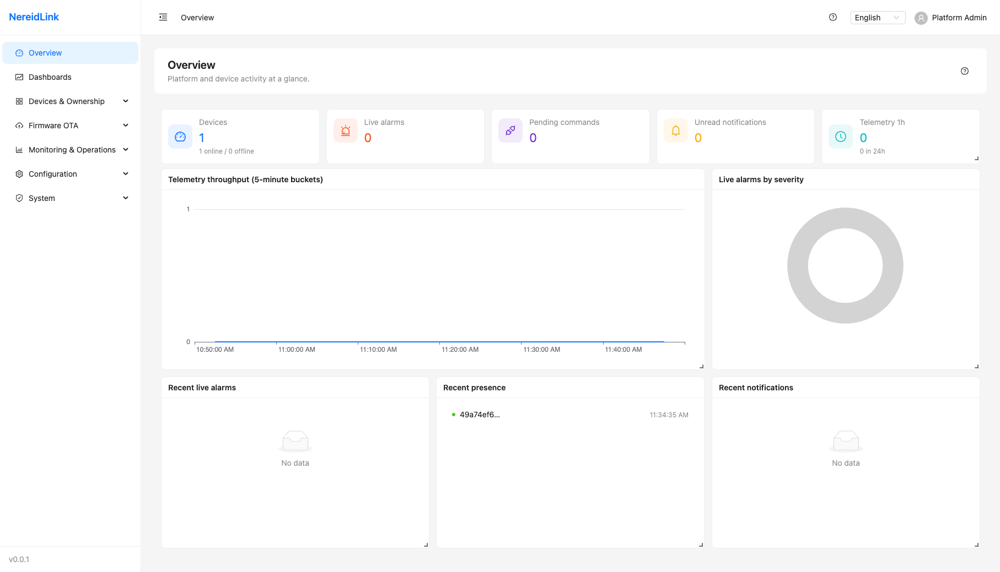

<!-- Copyright (C) 2026 YIQISOFT; SPDX-License-Identifier: Apache-2.0 -->

NereidLink
==========

An IoT data pipeline platform for private enterprise deployments, providing multi-protocol device connectivity, a unified messaging pipeline, a rule engine, alarms, and real-time visualization.

- One codebase, two deployment forms: an all-in-one single binary or Kubernetes microservices.
- Technology stack: Go, gRPC, NATS (Core/JetStream/KV), PostgreSQL + TimescaleDB, and S3-compatible object storage.
- All real-time data is pushed over WebSocket; polling is prohibited.



See `docs/` for product capabilities, API and protocol references, and operator runbooks. Deployment guides are linked below.

## Architecture Overview

One codebase supports two deployment forms: an all-in-one single binary (the current default) and a multi-container Kubernetes cluster split by serve role. Regardless of the deployment form, services communicate only through NATS; direct cross-service database access is prohibited.

### Logical Architecture (Independent of Deployment Form)

```
 Devices/Clients
 ┌────────────────────────┐  ┌────────────────────┐  ┌──────────────────────┐
 │ Gateway (NereidEdge)   │  │ Direct devices     │  │ Browser / business   │
 │  └ Subdevices ×N       │  │                    │  │ application          │
 └───────────┬────────────┘  └─────────┬──────────┘  └──────────┬───────────┘
             │ MQTT (TLS/mTLS)         │ MQTT / HTTP            │ REST / WSS
 ┌───────────▼─────────────────────────▼────────────────────────▼───────────┐
 │ Connection plane  ingress (mochi MQTT) · ingest-http · api (REST/WS)     │
 └───────────┬───────────────────────────────────────────────────┬───────────┘
             │ nl.telemetry / attribute / event                  │ WS fanout
             │ nl.presence / alarm (Core NATS)                   │
 ┌───────────▼───────────────────────────────────────────────────▼───────────┐
 │ Message backbone  NATS: Core + JetStream (TL/AT/EV_S0..15, AL, EG) + KV  │
 └───────────┬───────────────────────────────────────────────────────────────┘
             │ Partitioned consumption (1024 logical partitions / queue group,
             │ preserving per-device order)
 ┌───────────▼───────────────────────────────────┐  ┌────────────────────────┐
 │ Processing plane                              │  │ Singleton services     │
 │  rule-processor   Rule-chain DAG              │  │ (one elected leader)   │
 │  telemetry-writer Batch COPY → Timescale      │  │ presence offline       │
 │  egress-worker    External forwarding + DLQ   │  │ derivation, deadman,   │
 └───────────┬───────────────────────────────────┘  │ retention, digest,     │
             │ Writes / forwarding                  │ OTA, and audit         │
 ┌───────────▼───────────────────────────────────┐  └────────────────────────┘
 │ Data plane  PostgreSQL + TimescaleDB (hypertable · CAGG · compression)    │
 │             and S3-compatible object storage                              │
 └───────────────────────────────────────────────────────────────────────────┘
                egress-worker ──► External systems over HTTP/MQTT/NATS/AMQP/
                                  Kafka/Email/SMS
```

### Form 1: All-in-One (Current Default; Typical Scale: Hundreds of Gateways / Tens of Thousands of Subdevices)

```
 ┌──────────── Single container · single binary: nereidlink serve ────────────┐
 │ ingress │ ingest-http │ api │ rule-processor │ telemetry-writer │ egress  │
 │ and singleton services                                                     │
 │ :1883 MQTT                              :8080 REST/WS                      │
 └─────────────────────────────┬───────────────────────────────┬──────────────┘
                               │                               │
                        NATS node (R1)               PostgreSQL + Timescale
                                                       (single instance)
```

### Form 2: Kubernetes Cluster (Same Image Split into Containers by Serve Role; HPA/KEDA Scale Against Bottlenecks)

```
                               ┌──────────────┐
  Gateways/direct devices ──MQTT:1883──►│ L4 Service   │   Users/apps ──HTTPS/WSS──┐
                               └──────┬───────┘                           │
                         ┌────────────┼────────────┐                 ┌─────▼─────┐
                      ┌──▼──┐      ┌──▼──┐      ┌──▼──┐              │ api ×N    │
                      │ingr.│      │ingr.│      │ingr.│ HPA:connections│ HPA:CPU │
                      └──┬──┘      └──┬──┘      └──┬──┘              │ /RPS      │
                         └────────────┼────────────┘                 └───────────┘
                                      │ (pod name = unique ingress ID)
                           ┌──────────▼───────────┐
                           │ NATS StatefulSet R3  │ Core · JetStream · KV
                           └──┬──────┬──────┬─────┘
                  KEDA:lag    │      │      │ KEDA:lag
                      ┌───────▼┐ ┌───▼─────┐ ┌▼──────────┐
                      │ rule-  │ │telemetry│ │egress-    │
                      │processor│ │-writer  │ │worker ×N  │──► External systems
                      └────────┘ └───┬─────┘ └───────────┘
                                     │
                              ┌──────▼──────┐   ┌──────────────┐
                              │ PgBouncer   │──►│ PG primary   │
                              │ (txn mode)  │   │ + read repl. │
                              └─────────────┘   │ Timescale/S3 │
                                                └──────────────┘
  Singleton roles: active-standby Deployments with Kubernetes Lease leader
  election (not autoscaled)
    presence-sweep · deadman · retention · digest · ota · provision · audit · probe
```

### Serve Role → Kubernetes Workload

| Serve role | Kubernetes workload | Scaling signal |
|---|---|---|
| `ingress` | Deployment ×N; pod name is the unique ingress ID | Connections / CPU (HPA, KEDA) |
| `api` | Deployment ×N | CPU / RPS (HPA) |
| `rule-processor` | Deployment ×N | JetStream backlog lag (KEDA) |
| `telemetry-writer` | Deployment ×N; each replica owns a subset of streams | JetStream backlog lag (KEDA) |
| `egress-worker` | Deployment ×N | JetStream backlog lag (KEDA) |
| Singleton services | Active-standby Deployments with Lease leader election | Not autoscaled |
| NATS / PG | StatefulSet (NATS R3; PG + PgBouncer/read replicas) | Stateful layer, operated independently |

> Current status: the all-in-one form is implemented. The Kubernetes form currently runs a single replica (Helm `replicaCount: 1`); serve-role switches, unique ingress IDs, Lease leader election, and KEDA are cluster-scaling evolution items.

## Running NereidLink

One codebase, three run shapes. Pick by purpose; this README holds the
quickstart, while operator-grade details live in `deploy/` and on the
documentation site (<https://nereidai.github.io/latest/>):

| Shape | What runs where | Best for | Details |
|---|---|---|---|
| Local development | Go backend and Vite on the host; PostgreSQL/NATS in containers | Day-to-day coding and debugging | Below |
| Docker Compose | Full split stack (backend, frontend, PostgreSQL, NATS) on one host | Single-host trials and image verification | [`deploy/docker-compose/README.md`](deploy/docker-compose/README.md) |
| Kubernetes / K3s | Helm chart with bundled PostgreSQL and NATS | Production and clustered deployments | [Kubernetes & Helm](https://nereidai.github.io/latest/deployment/kubernetes/) · [`deploy/README.md`](deploy/README.md) |

### 1. Local development (host processes)

Requirements: Go 1.27, Node.js 24+, Docker Engine with the Compose plugin.

```bash
make infra-up       # PostgreSQL/TimescaleDB + NATS/JetStream containers (docker-compose.dev.yml)
make migrate        # create/update the schema against configs/dev.yaml
make seed           # optional: seed data and the deterministic dev admin password Admin12345!

# terminal 1: backend — REST/WS on :8080, MQTT on :1883/:8883 (configs/dev.yaml)
make dev
# terminal 2: Vite dev server — proxies /v1, /ws and /api to :8080
make web-dev
```

Open <http://127.0.0.1:5173>. Stop the infrastructure containers with
`make infra-down`.

### 2. Docker Compose (single-host split stack)

`deploy/docker-compose/` runs the production-shaped topology on one host:
PostgreSQL/TimescaleDB, NATS/JetStream, the PKI and migration one-shot jobs,
the `nereidlink-backend` service and the static `nereidlink-frontend` nginx
service. With registry access it starts without local configuration, because
it defaults to the rolling `0.0.0-dev` channel republished on every push to
`main`:

```bash
cd deploy/docker-compose
docker compose up -d
docker compose ps
curl -s http://127.0.0.1:18080/healthz
```

Pin a formal release by copying `.env.example` to `.env` and setting
`NL_VERSION` to a bare SemVer tag (for example `0.0.1`). On a host without
GHCR access, build both images locally (`make image`, `make image-frontend`;
regional proxies go through the git-ignored `local.mk`) and tag them with the
`ghcr.io/nereidai/...` coordinates the compose file expects. The frontend
serves static assets only and the console uses same-origin relative paths, so
a path-splitting edge is required for the UI: production uses the host nginx
(Mode A) or the bundled certbot edge (Mode B), and a loopback trial edge on
`127.0.0.1:18082` is provided as `docker-compose.local.yml.example`. TLS edge
modes, upgrades, MQTT access, license import and troubleshooting:
[`deploy/docker-compose/README.md`](deploy/docker-compose/README.md).

### 3. Kubernetes / K3s

The Helm chart under `deploy/kubernetes/helm/nereidlink/` provisions the
backend and frontend Deployments, bundled PostgreSQL/TimescaleDB and NATS,
Ingress path splitting and the MQTT NodePort services:

```bash
deploy/kubernetes/scripts/deploy.sh upgrade   # install/upgrade plus first-run bootstrap
deploy/kubernetes/scripts/smoke.sh            # readiness, healthz, captcha and SPA probes
```

Deployment architectures, namespaces and the two delivery forms are explained
in the suite documentation: [Kubernetes &
Helm](https://nereidai.github.io/latest/deployment/kubernetes/) and
[Air-Gapped Installation](https://nereidai.github.io/latest/deployment/air-gapped/).
Chart values, BYO infrastructure, HA topology and SSO/license operation:
[`deploy/README.md`](deploy/README.md).

### First login and persistent state

A fresh database has `admin@nereidai.local` with an empty password; the console
shows a bootstrap screen where the first visitor sets the administrator
password exactly once (there is no shipped default password; the `make seed`
dev shortcut sets the deterministic `Admin12345!` instead). Never delete the
`nldata` Docker volume or the Kubernetes PVC: it holds the device PKI, the
tenant-secret KEK and the license clock, and deleting it makes previously
sealed secrets undecryptable. A product overview and the first-device walkthrough
are on the documentation site: [NereidLink](https://nereidai.github.io/latest/products/nereidlink/)
and [Getting Started with NereidLink](https://nereidai.github.io/latest/guides/link/getting-started/).

The current version is the latest `v*` git tag (bare SemVer in artifact coordinates); non-tag checkouts build the rolling `0.0.0-dev` channel.

## Acknowledgments

NereidLink thanks the maintainers and contributors of the upstream projects
used by the product, including:

- [Mochi MQTT](https://github.com/mochi-mqtt/server) (MIT) for the embedded
  MQTT broker and [NATS.go](https://github.com/nats-io/nats.go) (Apache-2.0)
  for messaging;
- [pgx](https://github.com/jackc/pgx) (MIT) for PostgreSQL access and the
  [Eclipse Paho MQTT Go client](https://github.com/eclipse/paho.mqtt.golang),
  used under EDL-1.0/BSD-3-Clause, for device-side MQTT connectivity;
- [React](https://github.com/facebook/react) and
  [Ant Design](https://github.com/ant-design/ant-design) (both MIT), and
  [Apache ECharts](https://github.com/apache/echarts) (Apache-2.0), for the
  web console;
- [Swagger UI](https://github.com/swagger-api/swagger-ui) (Apache-2.0) for
  the vendored API documentation viewer.

These projects retain their own licenses, as detailed in
[THIRD_PARTY_NOTICES](THIRD_PARTY_NOTICES). Their inclusion does not imply
that the upstream projects endorse NereidLink.

License: Apache-2.0 (see [LICENSE](LICENSE)). The bundled database image contains TimescaleDB Community Edition under the TSL. See [THIRD_PARTY_NOTICES](THIRD_PARTY_NOTICES) for third-party components and licensing obligations.
